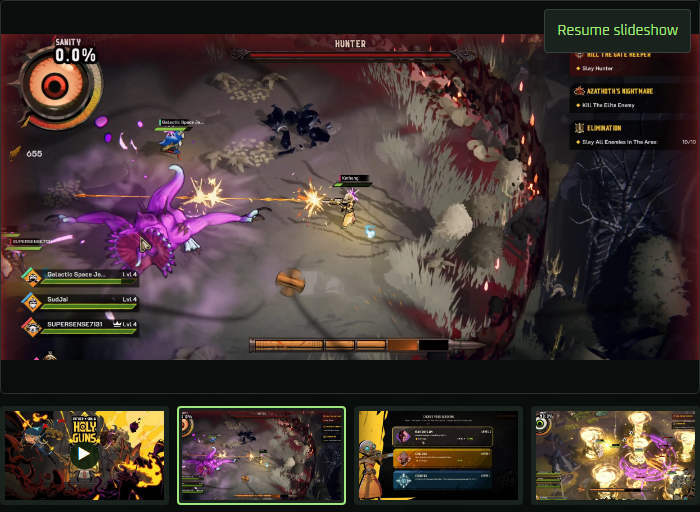
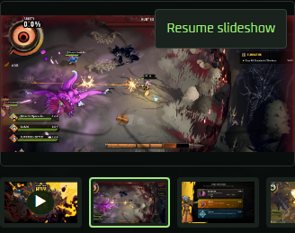

# Ticket #90: gameplay viewer slideshow control

The owner authorized implementation, testing, branch push and a PR to main on 2026-10-12, superseding the ticket's earlier planning hold. The implementation branch is `codex/issue-90-gallery-control`, based on fetched main `c0cbde0c8396b5fab011477cfb040ad29f57d3cb`. Unrelated work in the original checkout was preserved. This delivery does not merge or publish the website.

## Acceptance

- Shared multi-item galleries remove the entire caption row, visible counter/media label, Watch on YouTube link and reserved space. The separate hidden selected-item announcement remains.
- One visible Pause slideshow / Resume slideshow button sits at the viewer's top-right on video and photos. It is a separate element from the photo opener and iframe, has a 44px target, opaque background and visible keyboard focus. Empty and single-item galleries omit it.
- Explicit pause survives manual selection and remains independent in all five mounted galleries. Both video showcases retain their five-second photo interval; image-only galleries retain 6.5 seconds. Existing completion, readiness, error recovery and temporary inspection suspensions remain.
- Reduced motion starts paused in every gallery. Explicit Resume enables progression with immediate photo transitions. A live change to reduced motion pauses all gallery types.
- Pointer sequences originating on the overlay cannot initiate photo swipes. Pointer, keyboard and touch activation do not open image inspection; controlled provider checks verify player playback independence.

## Validation

- `npm run check:workstation`: passed; GitHub CLI account `komed-uth`.
- `npm ci`: installed locked dependencies in the isolated checkout.
- `npm run build`: passed production build and TypeScript check.
- `npm run check:preview`: 99 tests passed.
- `npm run check:runner`: 124 tests passed.
- `npm run check:overlays`: five parser tests passed. Original report capture lists are empty, so real capture overlays remain unavailable; the full browser suite includes the synthetic integration fixture.
- `npm run check:slideshow`: passed. Recorded evidence: `.scratch/browser-runs/run-wEhKQ8/`. Includes all five controls, pause persistence, independent Resume, keyboard inspection/focus, reduced-motion Resume, real touch activation and overlay-origin gesture isolation, plus the pre-existing slideshow checks.
- `npm run check:photos`: passed after narrowing the reduced-motion assertion to the image opener, because the viewer now also contains the slideshow button. Recorded evidence: `.scratch/browser-runs/run-FzQJtv/`.
- `npm run check:browser`: all thirteen stages passed in final recorded run `.scratch/browser-runs/run-fr18eU/`. The [retained run summary](assets/issue90/browser-summary.json) records the source-input fingerprint and each passing stage. The run began before the test-compatibility commit; its content fingerprint remained unchanged throughout, including after that commit. Intermediate runs exposed existing assertions tied to the removed presentation: a native photo swipe originated in the new button area, a viewer-button selector assumed only one button, and a photo check still required the caption. The swipe now begins in the photo's center, the animation check targets its existing image-opener locator, and photo/video layout assertions use the same caption-absence/overlay/spacing check. The separate overlay-origin test verifies that control gestures do not swipe. These corrections required no production-code changes.

Existing responsive checks assert caption/link absence, a 12px viewer-to-strip gap and an unclipped top-right 44px control across both video showcases and all three image-only galleries in normal/reduced motion. Existing in-memory empty/single fixtures assert slideshow control omission. Narrow/wide screenshots were visually inspected at 360px and 1366px, with complete photo framing and no caption gap:

## Review against main and ticket

Two independent GPT-6.1 Sol reviews at high effort examined `git diff c0cbde0c8396b5fab011477cfb040ad29f57d3cb...HEAD` after the implementation commit.

**Standards:** no documented-standard violations. One optional Duplicated Code heuristic: selection/inspection helpers in the new control check repeat small helpers in the existing slideshow check; sharing them could also remove their module cycle. This is non-blocking and the focused checks pass. Incremental test compatibility commit `562f1ba` was independently reviewed with no additional findings.

**Spec:** no implementation omissions, scope creep or wrong implementations. All three incremental test compatibility corrections were also reviewed and accepted. A visual note requested inspection of the real player's controls alongside the overlay. Live Regulus playback with the player controls visible was inspected at 360px and 1366px: central playback, timeline and lower player actions remain clear of the top-right slideshow control. This spot check does not certify every provider state.

## Merge risk

Two-way door; rollback restores the shared gallery presentation and pause eligibility without a data migration. Blast radius is the five shared multi-item galleries and future uses of that component. Viewport checks do not certify physical devices, and controlled provider checks do not certify every live YouTube state.
