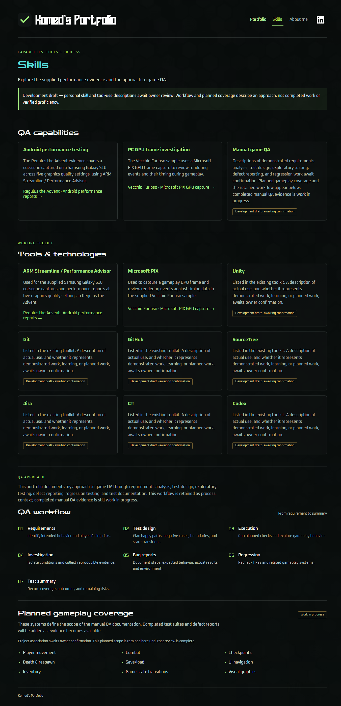
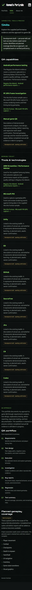

# Ticket #75 validation and review

Implementation, testing, branch push, and a PR were authorized by the owner's explicit request on 2026-10-12, superseding the earlier implementation hold. The owner later authorized merging the PR and closing #75 on the same date. `main` triggers Pages deployment. The marked development drafts retain the separate personal-content and planned-coverage association handoff in #77.

## Integration before merge

The first merge attempt was rejected after `main` advanced with PR #80 (About me, #76) and PR #81 (preview-strip arrow removal, #73). Integrated published main `f0d0b4b873c27ea82ca3f25f8d7a0a34368d9242`, preserving About me and the arrow cleanup. Skills replaces QA approach, legacy `#/about` redirects to Skills, and the header order is Portfolio, Skills, About me, LinkedIn. The old QA approach module is superseded by Skills. Both page checks and their full-suite registrations are retained.

The integrated production build, 99 preview/parser/selection tests, focused Skills checks, and focused About me checks passed. [Integrated preview output](integrated-preview-output.txt), [Skills summary](integrated-skills-summary.json), and [About me summary](integrated-about-me-summary.json) preserve these results. Screenshots below were refreshed to the integrated three-page header. Full build/browser CI on the integration commit is the final merge gate; results are visible in [PR #79 checks](https://github.com/komed-uth/Game-QA-Portfolio/pull/79/checks).

## Acceptance evidence

- Implementation base: `6bb08cbed1083e661c7cd65147185412d2d3f71e` (published `main`). The isolated `codex/issue-75-skills` worktree preserved unrelated planning changes in the original checkout. The fetched base was an ancestor of HEAD with no local-only commits before implementation.
- Production build, including TypeScript: passed.
- Preview-startup, overlay-data parser, and suite selection tests: 81 passed, 0 failed.
- Focused `--skills-only` rendered checks: passed. Direct/reloaded Skills and legacy links, active navigation/title, Back/Forward and legacy history replacement, section order, seven numbered workflow steps, nine planned systems and Work in progress, visible draft distinctions, four evidence links with original report/capture inspection, page-change scroll, keyboard activation/focus, skip link, and eleven viewport layouts all passed.
- The first isolated-checkout preview attempt failed because its own dependencies were missing. Installing the lockfile dependencies resolved the setup failure.
- The first rendered layout run found a Skills link narrower than 44px. Adding shared navigation minimum width corrected it; subsequent focused checks passed.
- Full production regression suite: all 12 groups passed. [Recorded summary](browser-summary.json) and [streamed output](browser-output.txt) preserve the input fingerprint, tested commit `263d1ff9e2a502e831db56d1f604c4593e056f15`, clean tracked-input status, durations, and results. [Preview test output](preview-output.txt) records 81/81 passes.
- GitHub `build-and-browser` passed on published head `147c443fbbcb3747748f55c2cfa587eeeab1e004`; [status snapshot](github-checks.json) records that head and result. Later commits only record evidence/documentation and ignore temporary capture output; the application and validation inputs match the tested implementation.

Viewport checks: 1920×1080, 1366×768, 390×845, 845×390, 360×840, 840×360, 1200×800, 800×1200, 899×700, 901×700, and 320×700. Navigation stays visible, keyboard focus is visible, targets are at least 44×44px, and there is no horizontal overflow. Desktop and phone screenshots were visually inspected for section order, wrapping, unclipped content, and retained dark background, typography, and green accents. These are browser viewport checks, not physical device certification.

## Standards

Review target: implementation commit `263d1ff`, before the evidence/documentation commits.

Independent GPT-6.1 Sol review at high effort against `git diff 6bb08cbed1083e661c7cd65147185412d2d3f71e...HEAD`: no documented standards violations. One optional judgement call: capability and tool cards repeat heading, description, and evidence/draft markup in `Skills.tsx`. A shared card could centralize future presentation changes. Retained the small local markup for this slice; this is not a correctness issue or hard repository rule.

## Spec

Independent GPT-6.1 Sol review at high effort against the same fixed point and issue #75 / parent #74: no actionable findings. Skills routing, relevant performance evidence, section order, retained workflow/planned scope, and draft distinctions match #75. Missing final personal copy and About me are correctly deferred to #77 and #76.

Review totals: Standards 0 hard violations, 1 optional duplication observation; Spec 0 findings.

## Remaining gates

Core personal skill/tool descriptions and the project association for planned coverage still require owner review in #77. Tool names and the workflow are not proof of unconfirmed proficiency. About me was absent from the original implementation base; the independently merged #76 page is preserved in the integrated result. No percentage bars or expert ratings were added. Original reports and evidence were preserved. Real report-owned screenshot overlays remain uncertified because the supplied report screenshot path lists are empty; the existing synthetic overlay fixture covers integration only. The owner's later merge instruction authorizes the existing Pages workflow publication of the marked development drafts.
