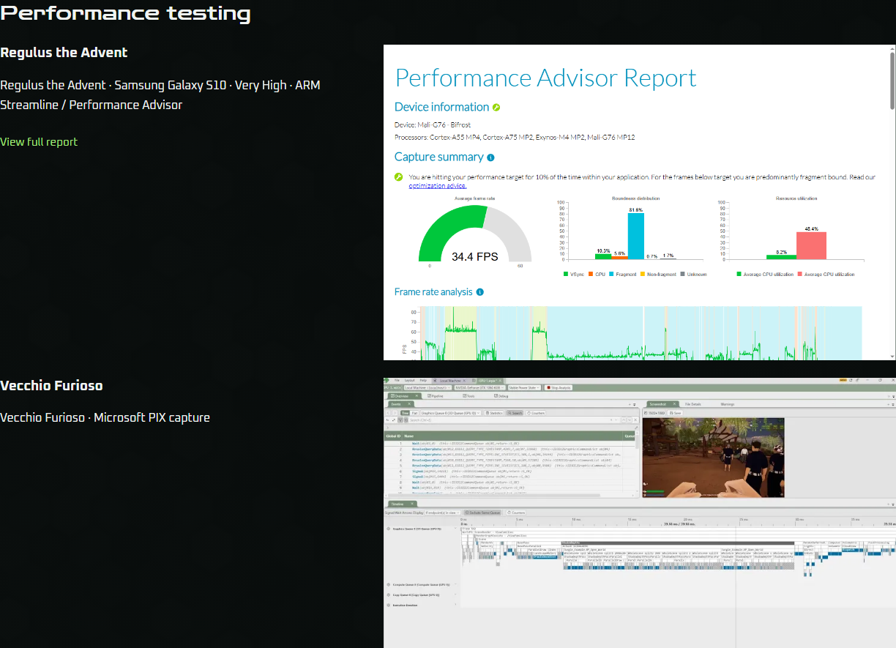
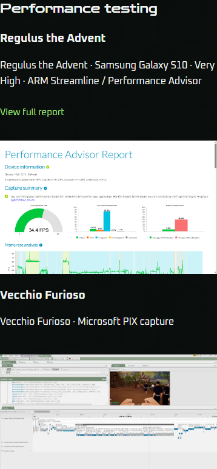

# Ticket #128 acceptance and review

Tracker: [#128](https://github.com/komed-uth/Game-QA-Portfolio/issues/128), parent [#126](https://github.com/komed-uth/Game-QA-Portfolio/issues/126).

> **Authorization status as of 2026-10-15**
> - **Source:** Owner instruction in the implementation chat: implement #128, follow repo guidance, review against the ticket, push the working branch and create a PR to main; do not monitor the PR validation workflow.
> - **Implementation and tests:** Authorized; implemented and reviewed. Final complete-suite evidence is recorded below.
> - **Branch push and PR:** Authorized; publication follows final validation and whitespace/history guards.
> - **Merge and issue closure:** Not authorized. Neither #128 nor parent #126 is closed by this work.
> - **Deployment:** Not authorized.
> - **Separate content or release requirements:** Exact owner-supplied Regulus screenshot and existing PIX image, per #126/#128.
> - **Supersedes:** The 2026-10-14 ticket/specification hold only for implementation/testing and branch push/PR. The owner explicitly excludes PR workflow monitoring, so merge-readiness workflow inspection is not run in this task.

## Acceptance

- Skills has one Performance testing section after the complete Tools list: Regulus the Advent, then Vecchio Furioso. Both use shared project/evidence references, details beside fully framed images above 900px and details above images at/below 900px.
- Regulus uses the exact 1196 x 735 owner screenshot. SHA-256 `2af1cd48868dba32abf8a8a5057293f2e52e4406d970570412be020a75edc542` matches the supplied planning asset byte-for-byte. Attribution explicitly names Samsung Galaxy S10, Very High, ARM Streamline / Performance Advisor and the partial frame-rate chart in its alternative text. The longer original image is retained but not used as preview.
- All six quality/summary choices are removed. One View full report action resolves directly to `S10_Very_High_Fixed.html`. Charts/tooltips, report toggles, documentation tabs, iframe keyboard boundaries, original HTML access, visit-local scroll memory, reload reset and reduced motion are covered.
- The two images open through the shared viewer, with correct image originals, accessible names, keyboard activation, focus restoration, background locking and dismissal. Report originals point to HTML. Neither evidence display remains on Portfolio; both games keep details, stores and gameplay galleries and link to the matching Skills row.
- All four capability/tool links, both project links, direct Skills destinations and saved Portfolio `evidence=android-reports` / `evidence=pix-capture` destinations reveal the row. Arrival/reload/history tests cover focus, viewport visibility and replacement forwarding without loops.
- Content workflow tests reorder supported Skills sections and real evidence rows through data, preserve report inspection while reordering, verify shared provenance/assets, and reject missing/hidden/duplicate targets. Visibility follows actual Skills render targets; hiding a Portfolio project does not hide its Skills row. Editing guidance describes the final contract.
- Original HTML reports, game media, PIX and prior longer summary images remain stored. No secondary report selector, new charts, gallery strip or slideshow is introduced for these evidence rows.

## Standards

GPT-6.1 Sol, high effort, independently reviewed the committed diff against fixed main `78bb1d03345f880f36ecc73523aa5ca3f7155991`. The review found four corrupted Unicode contact expectations plus two helper-design heuristics. Restored the arrows, renamed the report helper and removed unused visibility arguments. Follow-up at `8fb3940c0ca17056b1c758109fa89c4fb1e4f1bf`: no remaining findings.

## Spec

A separate GPT-6.1 Sol, high effort, reviewed #128/#126 against the same fixed point. Removed stale Low/High report-choice assertions without removing unrelated gallery resize, keyboard, focus or independence coverage; restored the unrelated LinkedIn expectations. Follow-up at `8fb3940c0ca17056b1c758109fa89c4fb1e4f1bf`: no remaining specification findings.

Review summary: Standards 0 remaining; Spec 0 remaining.

## Validation

Reviewed source and final browser-run commit: `8fb3940c0ca17056b1c758109fa89c4fb1e4f1bf`. Production source/assets are byte-for-byte unchanged from the successful final build at `320289bd0516b30a3e251c54db062bdaedfdb3b6`; the later commit changes browser checks only.

- Workstation preflight, dependency readiness, content validation, strict TypeScript and production build: PASS.
- Complete content-editing workflow: PASS, including rapid invalid/corrected saves, all page/project edits, reordered real evidence rows, responsive presets and retained report inspection; canonical source/build restored before browser validation.
- Overlay parser/readiness checks: PASS. Supplied reports have no real capture screenshot paths; their explicit SKIP is retained. Synthetic overlay coverage verifies the real report chart-to-image integration without claiming real capture certification.
- Preview checks: 108/108 PASS. Browser-runner checks: 151/151 PASS.
- Focused report and Skills checks passed during implementation. Failed exploratory/full attempts were not used as acceptance evidence; superseded assertions were corrected and the complete run restarted.
- Final complete portfolio suite: **PASS, all 13 checks**, with final input-stability gate passed. Local production preview, starting tracked changes `false`, tested commit `8fb3940c0ca17056b1c758109fa89c4fb1e4f1bf`. Input fingerprint `a2555656674819311c37ec8e2ff50efee1e9fe44f2af7b6a47a0764b7d857e81`. [Terminal summary](issue128/browser-summary.json) and [browser output](issue128/browser-output.txt) retain every check result. Documentation-only evidence commits after this run leave all fingerprinted inputs unchanged.

Evidence logs: [build](issue128/build-output.txt), [content workflow](issue128/content-workflow-output.txt), [overlays](issue128/overlays-output.txt), [preview](issue128/preview-output.txt), [runner](issue128/runner-output.txt).

## Visual inspection

Reviewed both Skills rows at desktop/phone widths and the Regulus enlarged-image view. Captures use the same production source and assets as the final run. All supplied pixels are preserved; desktop attribution and phone stacking remain readable without page overflow.

[Desktop Regulus inspection](images/issue128/regulus-modal-1366.png) | [Phone Regulus inspection](images/issue128/regulus-modal-390.png)

## Risk

Two-way presentation/data change. Main risk is evidence navigation or inspection regression; local rendered checks cover both moved targets and the retained HTML report. Viewport/touch automation does not certify physical devices. Real capture overlays remain unavailable in the supplied reports. No Git merge, ticket closure or deployment is performed.
