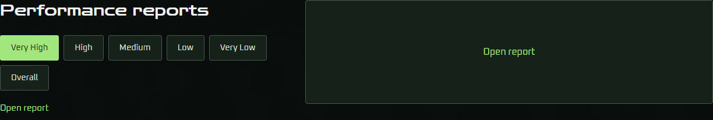
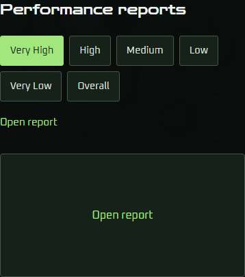
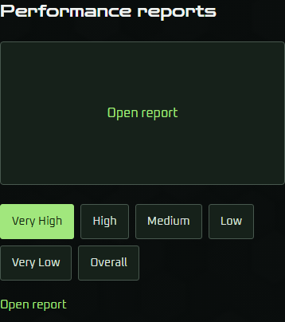
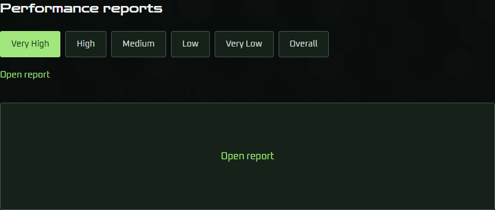
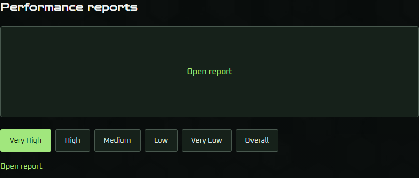

# Ticket #53: Preview-first reports on narrow screens

Implemented [#53](https://github.com/komed-uth/Game-QA-Portfolio/issues/53) from synchronized main `39163a87305127439863b78b2a53e282957ed1ca` on 2026-10-11. The owner's explicit implementation request supersedes the ticket's earlier implementation hold for this slice.

## Result

At widths of 900px or less, the report block presents Performance reports, the selected report preview, then the quality choices and their Open report action. The reading order and keyboard traversal follow that same sequence. Above 900px, the heading and controls stay left of report output. The nested report layout inherits the project grid columns, preserving desktop column widths and the existing preview frame.

The complete report block stays after Regulus project details, store links and gameplay. Surrounding project order, gallery behavior and the published text cleanup are preserved. Very High remains the initial selection; all six choices retain their order. The nonvisual selection announcement, named report output, and both opening actions retain selected-report context. Existing modal logic and visit-local inspection-position memory are unchanged.

## Visual evidence

These crops compare the original main production build with the implemented production build, both initially selecting Very High. Desktop is 1366 × 768, phone is 390 × 845, and the inclusive breakpoint is 900 × 900. The two desktop image files have identical SHA-256 hashes.

| View | Before | After |
| --- | --- | --- |
| Desktop |  |  |
| Phone |  |  |
| Exactly 900px |  |  |

## Acceptance evidence

- Fresh production/TypeScript build: passed.
- Preview-startup/selector/report-data tests: passed (39 tests).
- Browser-runner diagnostics/input-stability tests: passed (51 tests).
- Overlay-data tests: passed (5 tests); real capture paths remain unavailable.
- Focused reports: passed. The report-interactions check completed in 432.34 seconds; its synthetic overlay fixture also passed.
- Responsive report checks cover the existing ten viewports plus exactly 900px, including 899px and 901px. They verify preview-first narrow layout, desktop placement, report position after details/store links/gameplay, reading order, unchanged selection during repeated resizing, natural spacing, unchanged frame height, wrapping, 44px controls, and no page overflow.
- Keyboard traversal visits the preview, all six quality choices and the controls' opener in order. Opening and dismissal restore focus to the actual opener. Both actions target all six reports on mobile and desktop, with meaningful heading/region/group names and selected-state context.
- Existing report checks retain chart rendering, toggles/tooltips, original and documentation tabs, iframe focus/Escape, dismissal, background locking, independent per-report inspection-position memory, Overall two-axis immediate-close restoration, and reload reset.
- Complete browser suite: passed all eight checks (slideshow, photos, gameplay previews, representative media lists, evidence modals, evidence interactions, synthetic report overlay, and report interactions). The final report-interactions check passed in 389.15 seconds; the run ended with `PASS: rendered portfolio browser checks`.

The application and browser checks introduce no new testing seam. Original report evidence and unrelated working-tree changes remain outside the implementation diff.

## Independent review

Sol 6.1 high-effort Standards and Spec sub-agents reviewed `git diff 39163a87305127439863b78b2a53e282957ed1ca...cc7a52b97e5a8bf18dc3363785c93416f00c6101` against repository guidance and ticket #53.

- Standards: zero findings; no documented rule violations or actionable baseline code smells introduced.
- Spec: zero findings; no missing requirements, scope creep or incorrect implementation identified.

## Limits and risk

The supplied original reports have empty screenshot path lists, so real capture-overlay certification remains unavailable. The existing synthetic fixture verifies integration only. Browser viewports are not physical-device certification.

This is a reversible report presentation and accessibility change. It adds no persistent state, migration, report-content changes or gallery behavior changes. Desktop appearance is unchanged in the captured comparison.
